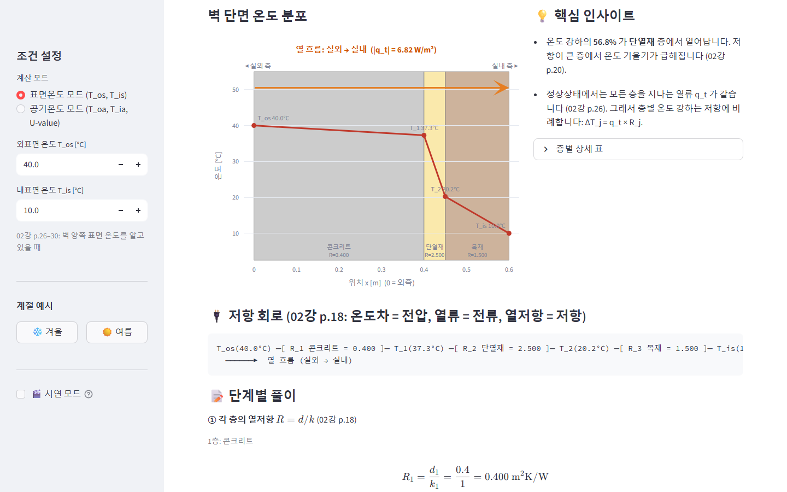
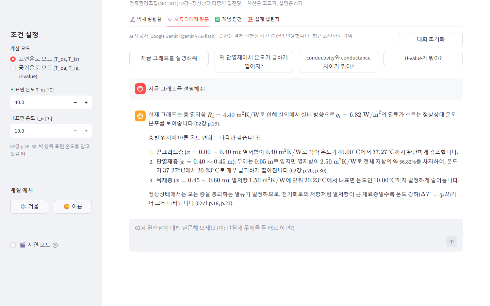
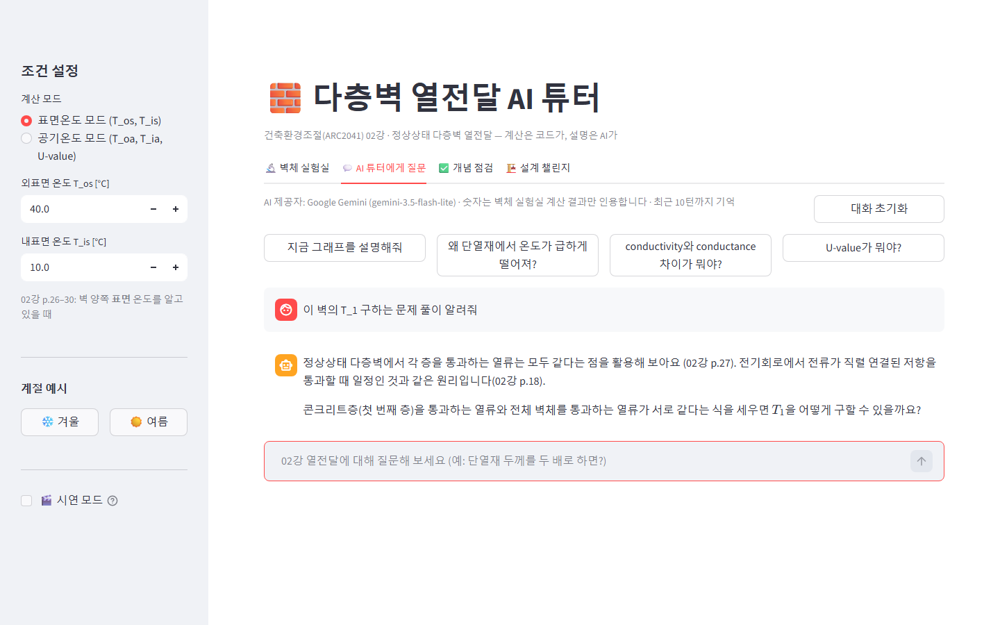
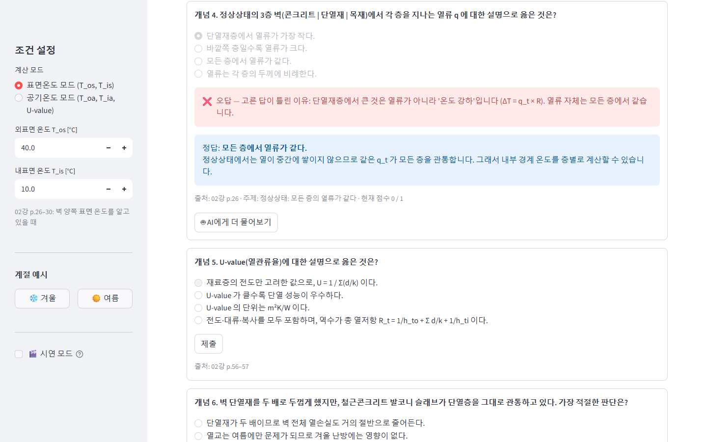
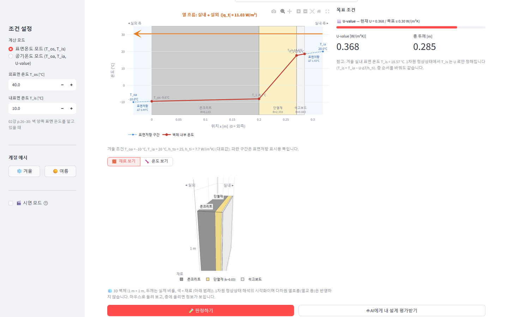
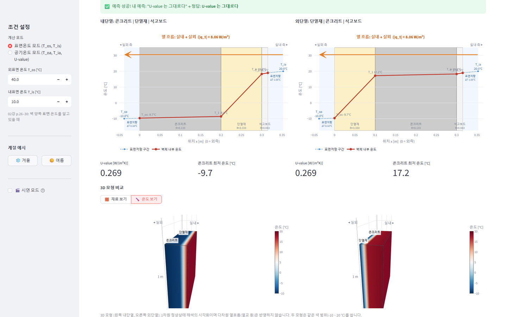

# 🧱 다층벽 열전달 AI 튜터

건축환경조절(ARC2041) 02강 **정상상태 다층벽 열전달**을 직접 만져 보며 익히는 학습 도구입니다.
벽 레이어를 쌓고 온도를 바꾸면 열저항, 열류, 경계 온도가 즉시 계산되고, AI 튜터가 그 결과를 설명해 줍니다.

> **설계 원칙: 계산은 코드, 설명은 AI.**
> 모든 수치(R, R_t, U, q_t, 경계 온도)는 `calc.py`가 결정적으로 계산하고 `pytest`로 검증합니다.
> AI는 계산하지 않습니다. 계산 결과(JSON)를 받아 인용하며 설명하고, 힌트를 주고, 질문에 답하는 역할만 합니다.
> 그래서 AI가 숫자를 틀리게 지어낼 여지가 없고, API 키가 없어도 계산기·그래프·퀴즈는 그대로 동작합니다.

## 기능

| 탭 | 내용 |
|---|---|
| 🔬 벽체 실험실 | 레이어 추가/삭제/순서 변경, 재료 프리셋(정리본 출처 표시), 표면온도·공기온도(U-value) 모드, 벽 단면 온도 그래프와 열 흐름 방향 표시, 저항 회로, 단계별 풀이, 규칙 기반 인사이트 |
| 💬 AI 튜터에게 질문 | 현재 계산 결과를 근거로 설명. 풀이 질문에는 힌트 질문부터 하는 소크라테스식, 정리본 페이지 출처 표기, 전기회로 비유 사용. **API 키가 있을 때만 활성화** |
| ✅ 개념 점검 | 랜덤 계산 문제 4개(R → R_t → \|q_t\| → 경계 온도, 정답은 calc.py, 허용 오차 ±2%)와 오개념 객관식 8문항(보기별 "왜 틀렸는지" 해설·출처 페이지). 점수 표시, 다시 풀기, "벽체 실험실에서 이 조건 열어보기", 사이드바 **시연 모드**(계산 4번 경계 온도 문제 고정). "AI에게 더 물어보기"는 키가 있을 때만 표시 |
| 🏗️ 설계 챌린지 | 목표 조건을 만족하는 벽을 직접 설계 (공기온도 모드, 겨울 -10 / 20 °C). Lv.1 단열재 두께 → U ≤ 0.30, Lv.2 단열재 종류+두께 → U ≤ 0.20·총 두께 ≤ 0.40 m, Lv.3 자유 설계 → U ≤ 0.15·총 두께 ≤ 0.45 m·구조층 최저 온도 ≥ 0 °C, Lv.4 콘크리트↔단열재 순서 바꾸기 예측(U 는 같고 온도 분포는 다름). 조건별 진행 막대, 3번 실패 시 규칙 기반 힌트, 클리어 표시. "AI에게 내 설계 평가받기"는 키가 있을 때만 표시 |

## 로컬 실행

Python 3.10 이상이 필요합니다 (3.14 에서 확인).

```bash
git clone <저장소 주소>
cd wall-heat-tutor
python -m venv .venv
# Windows: .venv\Scripts\activate    macOS/Linux: source .venv/bin/activate
pip install -r requirements.txt
streamlit run app.py
```

브라우저에서 `http://localhost:8501` 이 열립니다. API 키와 강의 정리본이 없어도 벽체 실험실과 개념 점검은 바로 쓸 수 있습니다.

테스트:

```bash
python -m pytest -q
```

정리본이 없는 저장소 상태에서는 정리본이 필요한 테스트 2개가 건너뛰어집니다(skipped).

## AI 튜터 설정 (선택)

AI 튜터는 **프로젝트 폴더의 `.env` 파일에서만** 키를 읽습니다. 화면에 키 입력칸은 없습니다.
`.env`가 없거나 키가 비어 있으면 AI 탭에 안내와 캡처 예시만 보이고, 나머지 기능은 정상 동작합니다.

1. `.env.example`을 복사해 `.env`를 만듭니다.
   ```bash
   cp .env.example .env            # macOS / Linux
   Copy-Item .env.example .env     # Windows PowerShell
   ```
2. 사용할 제공자 하나를 골라 채웁니다.

**Google Gemini** (무료 등급 사용 가능, 키 발급: [Google AI Studio](https://aistudio.google.com/apikey))
```dotenv
AI_PROVIDER=gemini
GEMINI_API_KEY=여기에_키
GEMINI_MODEL=gemini-3.6-flash
```

**Anthropic Claude** (키 발급: Claude Console의 API Keys 메뉴)
```dotenv
AI_PROVIDER=anthropic
ANTHROPIC_API_KEY=여기에_키
ANTHROPIC_MODEL=claude-haiku-5-5
```

`*_MODEL`을 비워 두면 위의 기본값을 씁니다. 저장한 뒤 브라우저를 새로고침하면 적용됩니다.

두 제공자는 같은 시스템 프롬프트, 같은 근거 자료(정리본이 있을 때 02강 발췌), 같은 계산 결과 JSON, 같은 대화 기록 제한(최근 10턴)을 사용합니다 (`tutor.py`).

> ⚠️ `.env`는 `.gitignore`에 들어 있어 커밋되지 않습니다. 키를 코드나 README, 이슈에 붙여 넣지 마세요.

## 강의 정리본 (저장소에 포함하지 않음)

**강의자료 저작권 때문에 강의 정리본은 이 저장소에 포함하지 않습니다.**
AI 튜터의 근거 자료로 쓰려면 **본인이 정리한 자료를 `data/건축환경조절_정리본.md`로 넣어 사용하세요** (형식은 [`data/README.md`](data/README.md) 참고).

- 정리본이 있으면: 튜터가 02강 관련 절(2.6–2.17, 핵심 공식 B–E)을 근거로 답하고 "(02강 p.57)"처럼 페이지를 표기합니다.
- 정리본이 없으면: AI 탭에 "근거 자료 없이 답변합니다" 안내가 뜨고, 튜터는 일반 교과 지식으로 답하며 페이지 출처를 표기하지 않습니다.
- 계산기·그래프·퀴즈는 정리본과 API 키가 모두 없어도 정상 동작합니다.
- 화면의 재료 프리셋·퀴즈에 적힌 출처 표기(예: "02강 p.18")는 수업 진도를 찾아보기 위한 참고 표시입니다.

## 화면 캡처

공개 저장소에는 API 키가 없으므로 AI 튜터 화면은 캡처로 보여 줍니다.
아래 6장은 **`docs/screenshots/`** 에 있으며, 키가 없을 때 앱의 AI 탭에도 '사용 예시'로 파일 이름순으로 표시됩니다
(앞 번호와 `_`를 뺀 이름이 캡션).

| 벽체 실험실 (정리본 예제 40 / 10 °C) | AI 튜터 — 그래프 설명 |
|---|---|
|  |  |

| AI 튜터 — 힌트 질문 | 개념 점검 — 오답 해설 |
|---|---|
|  |  |

| 설계 챌린지 — Lv.1 진행 중 (재료 보기 3D) | 설계 챌린지 — Lv.4 순서 바꾸기 비교 |
|---|---|
|  |  |

## 향후 확장

이번 버전은 02강 정상상태 1차원 열전달에 집중했습니다. 같은 "계산은 코드, 설명은 AI" 구조로 다음을 붙일 수 있습니다.

- **상당외기온도(Sol-air temperature)** — 일사 흡수를 외기온도에 더한 $T_{sol} = T_{oa} + \frac{\alpha}{h_t}q_{sol} - \frac{\varepsilon}{h_t}q_e$ 토글로 여름철 일사 영향 비교 (02강 p.65–66).
- **글레이저법(Glaser method) 결로 판정** — 같은 다층벽에 수증기 확산 저항 $s_d$와 포화수증기압 분포를 겹쳐 그려 내부 결로 위치 판정 (03강).
- **3D 시각화** — 모서리·발코니 슬래브 등 열교 부위를 3차원으로 보여 주는 시각화 (02강 p.68–74).
- **제로에너지건축 1차에너지 연계** — 벽체 U-value 로 연간 열손실을 추정하고 1차에너지 환산계수와 연결해 에너지자립률 관점에서 비교 (제로에너지건축 과목 연계).

## 파일 구성

```
app.py          Streamlit 화면 (탭 4개)
calc.py         계산 엔진 (직렬/병렬 열저항, 표면·공기온도 모드, 경계 온도)
tutor.py        AI 튜터 (.env 설정, 공통 프롬프트, Gemini/Anthropic 호출)
materials.py    재료 프리셋, 정리본 02강 발췌
quiz.py         개념 점검: 랜덤 계산 문제 생성·채점, 오개념 객관식
challenge.py    설계 챌린지: 레벨 정의·판정·힌트 (계산은 calc.py 그대로 사용)
data/           강의 정리본 자리 (저장소에는 미포함, data/README.md 참고)
docs/screenshots/  AI 튜터 캡처 이미지
tests/          pytest (계산 엔진, 튜터 공통 함수, 퀴즈, 설계 챌린지)
```

## 부호 규약 (정리본 02강)

- x = 0 은 외측, 실내 방향이 +
- $q_t = -K(T_{is} - T_{os}) = (T_{외측} - T_{내측})/R_t$ — 양수면 실외 → 실내, 음수면 실내 → 실외
- 경계 온도 $T = T_{외측} - q_t \sum R$ (외측부터 누적)
- 표면온도 모드의 $K_t = 1/R_t$ 는 표면저항이 빠져 있어 U-value가 아님. U-value는 공기온도 모드 $R_t = 1/h_{to} + \sum d/k + 1/h_{ti}$ 의 역수
